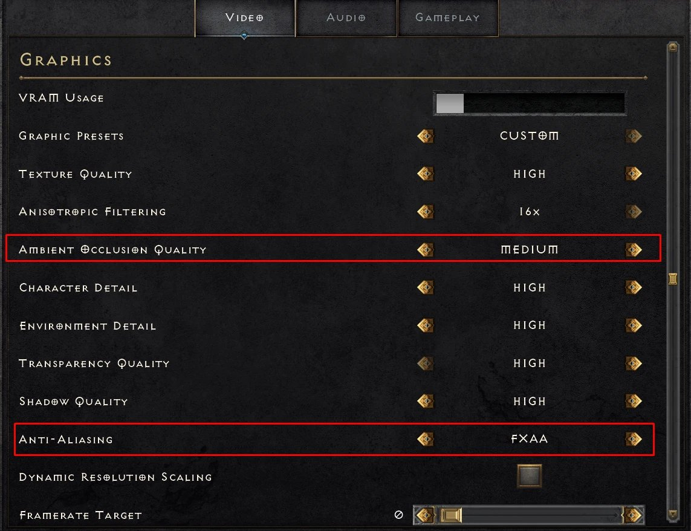
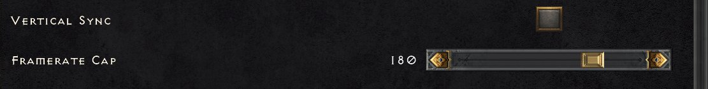
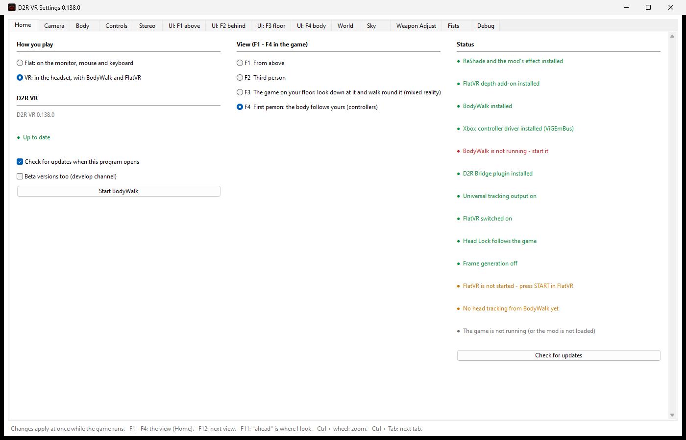

# D2R VR

Diablo II: Resurrected in a VR headset: the game's own view from above in true
3D, a free camera behind the hero, and the game laid on the floor of your room
(mixed reality), and first person with your body as the hero's: arms on the
controllers, the weapon in your hands - the blade you swing picks the target,
weapons have weight, you throw with your hand and draw a bow with both - with a
painted sky, depth fog and the game's day and night. On native OpenXR the mod
can read your controllers itself, with no BodyWalk needed for the controls (a
prototype).

**[Download D2R VR](https://bodywalkvr.com/api/download/latest?product=d2r_vr)** -
the ready installer, always the latest version. It sets up everything,
including a free BodyWalk Lite if you don't have BodyWalk.

**[Open the mod's page on BodyWalkVR](https://bodywalkvr.com/mods/d2r-vr)** - the
four views in video, the controls and the setup.

**What's new in 0.170:** D2R VR is a D2RLoader mod now - everything of it in
`mods\D2R-VR`, so it no longer shares files with the other VR mod and D2RLoader's
`-mod` picks which one runs (Setup moves an old install, your settings with it);
the shared D2R VR Launcher comes with Setup; the Arcane Sanctuary's own sky all
round, made from your own game's files, with an optional fog that fades into it; SteamVR thumbsticks that are bound to
nothing are told and read through a spare action, and a real gamepad joins the
plugin's pad; the ReShade settings of another mod no longer stop ours, and a ReShade
you already have (dxgi.dll) is used as it is; native OpenXR never hangs the game on a
busy headset, takes your own eye distance and draws canted displays right; a spell's
aim distance can follow your arm's reach (off); Hit by touch in the headset's panel,
and with it the trigger no longer attacks (a bow or a crossbow keeps it); skills on the right trigger and on A (off);
the wrist orbs under a shield
can be set per hero class (depth, along the arm and turn); the hero's own effects (Bone Armor) can
be faded (in the build, off, not working yet); a Barbarian's Double Swing by the two hands (off); the fog can
spare fire, spells and smoke (a test, off); no more hang at a portal into a new area. **In 0.169:** the weight and grip
libraries out of the plugins folder. **In 0.168:** no more frozen game in native OpenXR (the right eye goes
to the GPU in the game's own calls); weapons with weight by the hero's Strength
and a two-handed hilt grip; a flail's ball on a real chain; weapons, the bow, the
crossbow and the shield put away behind your shoulders; energy orbs along the bow
that pick the arrow skill, and arrows that burn, freeze or crackle; the crossbow
held by its grip; spells aimed by the hand or staff; buffs, auras, curses and
summons on your wrist; skills by the class's trees; Run / Walk on any button.
**In 0.167:** a faster picture in native OpenXR (our own depth, picked
once), the full controller in VR F1, F2 and F3 without BodyWalk, a shield on the
forearm, and settings from the fork d2r-pcvr (turning, the Steam Frame's layout,
vibration for each hand, menus that follow the VR render size). **In 0.166:** the
features of 0.165 are on by default. The settings
that come with the mod are now the author's own tuned configuration (0.165 went
out with the old ones, with everything new off). **In 0.165:** first person on
native OpenXR grows up. The plugin can read your controllers itself (*Controls without BodyWalk*, a prototype); the
blade you swing picks the target (*hit by touch*); weapons have weight; you throw
with your hand and draw a bow with both; a skill wheel and a settings panel hang
in the headset; life and mana sit on your wrists; F1 and F3 are in real 3D; and an
attack no longer runs the hero forward. The hand and weapon features are for
first person (F4). All versions:
[CHANGELOG.md](CHANGELOG.md).

**Want to help?** The roadmap, the known problems with what we know about
each, and notes for developers are in [docs/](docs/README.md) - fork it, fix
one and send a pull request.

**Discussion, bugs and ideas:** our Discord, channel
[#diablo-2-vr](https://discord.com/channels/1481909961897279562/1556377249484251298)
under *Game Mods* - not on the server yet? [Join it here](https://discord.gg/kVYjEdJx3e).
Tell us what works, what doesn't and what you would like to see.

> Offline single-player only. Injecting code into the game online can get the
> account banned. This project is not made, endorsed or supported by Blizzard
> Entertainment.

It is a [D2RLoader](https://d2rloader.net) mod, `mods\D2R-VR` in the game's folder: a plugin
(`d2rl-vrcam.dll`) and a ReShade effect (`D2R_DepthFog.fx`) with everything that goes with them
(`docs/d2rloader_mod.md`). For the headset it talks to BodyWalk through BodyWalk
Game Link (`external/bodywalk/game_link.h`, BodyWalk's `game_link` plugin), which
hands it the head and the hands; FlatVR (in BodyWalk) shows the picture in the
headset. Without a headset it plays flat on a monitor with mouse
and keyboard (F1 the game's camera, F2 third person, F3 first person).

## Views (F1 - F4 in the game, F12 goes round)

- **F1 From above** - the game's own camera; *Real geometry* draws it through our
  camera in true perspective and stereo.
- **F2 Third person** - a free camera behind the hero, turned with the head.
- **F3 The game on your floor** - look down at it and walk round it.
- **F4 First person** - the hero's arms follow the controllers and hold the
  weapon; the hero turns with you.

## The game's video settings

In Diablo II: Resurrected, Options > Video:

| Setting | Set to |
|---|---|
| **Vertical Sync** | **Off - important**: the mod draws the two eyes in turn, and VSync halves the frames each eye gets |
| NVIDIA DLSS | On or off - both work in stereo: each eye gets its own DLSS (in *Stereo - one pass, two pictures* the two eyes share one) |
| Framerate Cap | 180 (90 for each eye) |
| **Anti-Aliasing** | FXAA or MSAA - **not TAA**: it builds each frame from the ones before it and mixes the two eyes |
| Ambient Occlusion Quality | Any, Max included. It was Medium against dark ground at grazing angles; since 0.164 the game's ambient occlusion reads its depth from our camera (`[render] depth_fix`), and nothing in the mod depends on its quality |

### A square screen

For a square picture in the headset, either:

- **Native OpenXR's VR render size:** in D2R VR Authentic Settings > Home > In the headset
  drag *Resolution (VR render size)* to a size from 1024 to 4096 pixels a side,
  or tick *Use the headset's recommended size*. The game draws at that size
  whatever its window is; the window keeps its own size, no dragging (new: if
  it misbehaves, drag the slider to its left end, "window's size", and use one
  of the ways below); or
- **Windowed mode:** set the game to *Windowed* in Options > Video and drag
  the window's edges until it is square; or
- **FlatVR's virtual monitor:** in BodyWalk's FlatVR tab create a virtual
  monitor with a square resolution, move the game onto it, then switch the
  game to full screen there.

### The screen's size in the headset

How big the screen is, how far away and how curved: in BodyWalk, on the
**FlatVR** tab - or right in the headset, in FlatVR's overlay (**F10** by
default).

### The game in your room (F3, on the floor)

In D2R VR Authentic Settings > Camera > *F3 The game on your floor*, pick a **Background
round the game** colour (pure black or green). In Virtual Desktop turn on
passthrough with that colour as its colour key: the background is cut out and
the game stands in your real room.

## First start in the headset

From 0.171, the first time you stand in the world in first person (F4) on native
OpenXR with *Controls without BodyWalk*, a guide comes up in front of you:

1. **Measure yourself.** Without a stored measurement it offers the T-pose
   measurement first: push the right stick **up** to measure now, **down** to
   go on without it. Stand upright, arms out sideways at shoulder height, let go
   of both triggers, then squeeze both and hold still until it says *Saved*
   (the right B cancels). Your eye height sets the world's scale, your arm span
   fits the hero's arms.
2. **What to press for what.** Five short pages: walking and fighting, what
   opens the inventory, the map, the pause menu and the skill panel, the
   settings in the headset, the belt, weapons and the bow, and the F views.
   Right stick **up**: the next page, **down**: back, **held up a second**:
   close.

The guide presses nothing and takes no button: the game runs on behind it (the
right stick's up and down do nothing in the world), and it hides while a menu,
the skill panel or the settings panel is open. Finished or closed, it does not
come back by itself. To see it again: the settings in the headset, page **Body**,
*First-start guide*; or untick *First-start guide seen* in D2R VR Authentic
Settings > Body. *Show the first-start guide* unticked keeps it away
(`[onboarding]` in d2r_vr.ini). The idea of offering the measurement at the first
start is from bearstonem's [d2r-pcvr](https://github.com/bearstonem/d2r-pcvr) (MIT).

## Controls in F4 (first person)

> **Preview.** F4 is an early look, not a finished way to play the game: the
> weapons are not calibrated yet, so how a weapon sits in the hands and where
> it aims may be off for many of them. Weapon Adjust in D2R VR Authentic Settings lets you
> fix one by hand meanwhile.

On native OpenXR the plugin reads the controllers itself (**Controls without
BodyWalk**, D2R VR Authentic Settings > Stereo > Native OpenXR, on in the settings
that come with the mod). The layout in the world, as it comes:

| Control | Press | Held half a second | With the same hand's grip held |
|---|---|---|---|
| Left stick | walk | | |
| Right stick | left / right: turn (smooth, 180 degrees a second; snap turning in Controls) | | |
| Right trigger | attack (but see *Hit by touch* below) | | |
| Right A | pick up, open, talk | | |
| Right B | the game's skill button B | | RB, the fourth skill button |
| Left X, left Y | the game's skill buttons X and Y | | |
| Left trigger | LT: held, B X Y RB are the second row of skills | | |
| Right stick click | swap weapon sets I / II | the skill panel (again: closes it) | |
| Left stick click | the items on the ground named (Alt) while held; a quick click: the map | the inventory | recentre ("ahead" is where you look) |
| Menu button (PS VR2: the right controller's Options) | the inventory | the pause menu (Esc) | the map |
| Grips | nothing on the pad: they take a belt potion, hold the weapon, take a bow's string, a staff's second hand, the shoulders | | |

In a menu the controllers are the game's own gamepad (A B X Y, the sticks and
their clicks, the grips as bumpers, the triggers, the menu button as Start), and
the right controller's laser is the mouse: point and pull the trigger. Every line
of the layout is in `[direct]` of d2r_vr.ini and can be rebound - by hand, from
the lists in D2R VR Authentic Settings > Controls > Buttons of the controllers, or
on the Left and Right pages of the settings in the headset. With *Controls without
BodyWalk* off, BodyWalk's Mapping makes the controls, as before 0.165.

**Hit by touch** (Strikes tab, or the Melee page in the headset; on in the settings
that come with the mod). A sword, axe or mace hits the monster you swing it
through, and its trigger does not attack (*Trigger does not attack*); a bow and a
crossbow keep the trigger. The blade has to move at 6 m/s and 15 cm to count, in
those settings. A hard bash of the shield casts Smite when Smite is on one of the
skill buttons.

**The skill panel** (*Skill wheel* in D2R VR Authentic Settings > Stereo > Native
OpenXR, in the tiles' look). **Hold the right stick click for half a second** and it
opens in front of you; a short click is still the weapon swap, and the same hold
closes it (B, Y or Menu too). Point a controller at a plate and pull the trigger:
from then on that trigger casts its skill. EDIT SKILLS -> a plate -> a skill puts a
skill you have on it. *Skill panel: skills on
the right trigger and on A* (off) makes the right trigger and A the game's own RT
and A skill slots.

**The settings in the headset** (*Settings panel in the headset*, UI: F4 body >
Menus). With the skill panel in the tiles' look they are its **SETTINGS** tab: the
long press opens the window on the tab you used last, and both grips squeezed for
a moment, then a click of a thumbstick, open it on SETTINGS. Flip the pages - View,
Options, Video, Body, Life, Look, HUD, Belt, Melee, Left, Right - with a flick of a
thumbstick left or right, a tap of a grip (left back, right on) or the arrow at the
window's edge; point and pull the trigger to change a row, then Apply. View has
the game view's F1 - F4 buttons, Body the T-pose measurement and the first-start
guide.

**The belt.** The belt's potions hang at your hips. A hand at a bottle lights it
and the grip takes it; bring it to your mouth and tip it, and you drink; let it go
anywhere else and it goes back. Where the belt hangs: the Belt page in the headset.
Life and mana sit on your wrists.

**Weapons, shield, bow, throws.** A weapon has weight: hold it with the grip; let go
with both grips and it falls (a grip calls it back), and a second on the floor it
hangs on your back - a grip behind either shoulder draws it again. An empty hand's
grip behind the left shoulder puts the shield away and draws it. The bow: take the
string with the free hand's trigger or grip, pull back, let go; while the string is
drawn B loads the next arrow skill and A the one before, or point the free hand's
trigger at one of the energy orbs along the bow. The crossbow shoots with the
trigger. A javelin or throwing weapon: hold it with the grip, swing and let go; with
a javelin, the trigger tapped behind a shoulder picks the throw's skill (right hand
the next, left the one before). Spells go where your hand, wand or staff points.

**In F1, F2 and F3** the same controller is the game's gamepad when BodyWalk is not
running (*Controls without BodyWalk* on): the same layout without the skill panel,
the pause menu, the gestures and the hand's aim; the left stick walks, and the left
trigger held with a flick of a thumbstick drinks a belt potion (left = 1, up = 2,
right = 3, down = 4). With BodyWalk running, its gamepad is the gamepad:

| On the pad | On the VR controllers (BodyWalk) |
|---|---|
| Left stick (walk) | Left stick |
| D-pad up / down / left / right | Hold the left grip + left stick up / down / left / right |
| Map | Click the left stick |
| Menu | Hold the left stick down |
| Reset the centre ("ahead" is where I look) | Hold the right stick down |

Everything else is where the game's own gamepad layout puts it.

**The F keys.** F1 - F4 on the keyboard switch the view (the game window in focus),
F12 goes to the next one and F11 recentres; in the headset the View page has F1 - F4.

**Height calibration** (D2R VR Authentic Settings > Body > *Measure my height and
arm span*, or *Calibrate body* on the headset settings' Body page, or the
first-start guide). Stand upright with your arms out level at shoulder height (a
T-pose), let go of both triggers, then squeeze both and hold still for 1.2 seconds;
a panel in the headset leads you, and the right B cancels. It saves your eye height
and arm span (`[calibration]` in d2r_vr.ini): the eye height sets the world's scale
and the span fits the hero's arms, while the hands stay 1:1 with the controllers.
*Use the measured height and arm span* switches it on and off; *Forget the
measurement* clears it. It needs the headset's floor (a room set up) and first
person (F4).

## Requirements

- Diablo II: Resurrected 3.3.93787 under D2RLoader 1.3.1 (other builds need
  their addresses checked; the plugin says so in its log)
- ReShade with add-on support, its Generic Depth add-on on
- For the headset: native OpenXR with *Controls without BodyWalk* needs no BodyWalk; for
  FlatVR, BodyWalk 1.79 or later with its Game Link plugin (Setup puts it in; 1.83 for FlatVR
  with the plugin's own layout, *Game Link direct*)

## Settings

**D2R VR Authentic Settings** (`D2R_VR_Settings.exe`, next to `D2R.exe`; Setup puts a
shortcut of that name on the desktop and in the Start menu). Most changes apply at once
while the game runs. Start the game from it too: Home > **START** - no need to open the
game's folder.
Every tab, with a picture and what it is for: [SETTINGS.md](SETTINGS.md).

## Building

Visual Studio 2022+ with CMake:

    cmake -S . -B build -A x64
    cmake --build build --config Release

D2RLoader's plugin SDK is fetched from GitHub. The headers of BodyWalk, FlatVR
and ReShade the build needs are in `external/`. `installer/` builds the setup
(Inno Setup 6).

### Known problem: the source does not build as it is yet

**What fails.** The plugin draws the gesture runes BodyWalk scores
(`[openxr] runes_draw`). That code (`vr/rune_geom.h`, `vr/link.h`, `vr/link.cpp`)
uses a section of BodyWalk's Game Link header, `bodywalk/game_link.h`, called
*VrRunes*: `BW_LinkVrRune`, `BW_LinkVrRunes`, `BW_LINK_VRRUNES_*`,
`BW_LINK_RUNE_*` and `BW_LINK_CAP_VR_RUNES`. The header in `external/bodywalk/`
comes from BodyWalk's released SDK, which does not have that section yet, so the
build stops with "undeclared identifier" errors in `vr/link.h` and
`vr/rune_geom.h`. The installer's DLL is built with a header that has it.

**What to do meanwhile.** Build against a `game_link.h` that has the VrRunes
section: put it in a folder as `bodywalk/game_link.h` and give CMake that folder,

    cmake -S . -B build -A x64 -DBODYWALK_SDK_INCLUDE=<that folder>

The section only adds to the header, so the rest of it is the same.

**It will be fixed in a following release:** BodyWalk publishes the VrRunes
section in its Game Link SDK header, and the tree builds as it is. The runes
themselves also need a BodyWalk that sends them, which is not out yet.

## Thanks

The idea of a free 3D camera in D2R came from
[emmericp/D2R-3D](https://github.com/emmericp/D2R-3D). D2R VR has its own
camera and contains none of its code.

Thanks to **bearstonem** for [d2r-pcvr](https://github.com/bearstonem/d2r-pcvr)
(MIT), a fork of D2R VR: the laser pointer on menus and panels, the menus as a
panel in first person and the spells that fly along the hand with no
auto-target follow what that fork found in the game - where to hook, the extra
menu panels, the spell resolver and its call sites. So, in 0.165, do reading the
controllers directly, the skill wheel, the weapon swap over the shoulder, the
shield's Smite, the item tooltips at once, the controller vibration, hiding the
plates of ordinary monsters, the T-pose measurement, and the bow's arrow skills
and bones. And, in 0.167, the turn settings, the Steam Frame's layout, the Smite
press, the one-press interact, the vibration channels, the menus that wait for the
headset and follow the VR render size, the depth set at its source, the shield on
the forearm and our own depth bound once.

## Licences

D2R VR is MIT (`LICENSE`): use it, change it, build your own and share it -
keep the copyright notice. The licence does not cover the name "D2R VR" as a
mark, nor BodyWalk / FlatVR, which are separate products.

Third-party: MinHook (BSD 2-clause, `third_party/minhook`), the ReShade SDK
headers (BSD 3-clause, `external/reshade`), the D2RLoader plugin SDK (MIT).
Diablo II: Resurrected is Blizzard Entertainment's; this project is not affiliated
with or endorsed by Blizzard and ships none of the game's files.

## Say thanks

D2R VR is free and stays free - no paywalls, no exclusive builds. If you like
the project and want to thank the author, you can support it on
**[Patreon](https://www.patreon.com/c/d2vr)**: it pays for development time and
VR hardware for testing.
