# D2R VR Settings - a tour of the tabs

`D2R_VR_Settings.exe` sits next to `D2R.exe` (Start menu: *D2R VR Settings*).
Every change applies at once while the game runs; nothing needs a restart unless
the label says so. The settings live in `d2rloader\plugins\d2r_vr.ini`.

Keys in the game: **F1 - F4** pick the view, **F12** goes to the next one,
**F11** makes "straight ahead" wherever you are looking. In this program
**Ctrl + wheel** zooms the window and **Ctrl + Tab** goes to the next tab.

**What is ticked.** From 0.166 the settings that come with the mod are the
author's own tuned configuration, so most of the options below that say "off"
or "off by default" - hit by touch, weapon weight, the bow drawn with both hands,
controls without BodyWalk, the wrist medallions, the belt potions and others -
are ticked on a fresh install (and when Setup is told to take the default
settings). The text says what an option does; the program shows what is ticked.

The pictures show the VR set of tabs. With *Flat* chosen on Home the program
shows the flat set instead: views F1 - F3 and a *UI: F3 eyes* tab in place of
the headset-only ones.

---

## Home

- **START** - starts the game under D2RLoader, the way the mod runs (greyed
  while the game runs). With native OpenXR and *Controls without BodyWalk* it
  starts nothing else; with BodyWalk and FlatVR it starts BodyWalk too.
- **How you play** - *Flat* (the monitor, mouse and keyboard, no headset) or
  *VR* (the headset).
- **In the headset** - *3D in the headset*: **Native OpenXR** (the default: the
  game itself in the headset, no FlatVR needed), *FlatVR stereo* or *FlatVR 3D
  depth*; the headset's refresh rate; *My height*; and **Resolution (VR render
  size)**, a slider from 1024 to 4096 pixels a side (its left end is the game
  window's own size) with a tick box for the headset's recommended size. On
  native OpenXR the game draws at that size whatever its window is.
- **View** - the view the game starts in; the same as pressing F1 - F4:
  - **F1 From above** - the classic camera, in real 3D.
  - **F2 Third person** - the camera behind your hero, you look around with your head.
  - **F3 On your floor** - the game as a living diorama on your floor or table.
  - **F4 First person** - your body is the hero's: arms on the controllers,
    the weapon in your hands.
- **D2R VR** - the version, the update check (*Up to date* or a download
  button), the beta channel.
- **Start BodyWalk / Start FlatVR / Stop FlatVR** - start BodyWalk, then FlatVR,
  right from here. Each button shows only when it can do something.
- **Status** - everything the VR chain needs, top to bottom: ReShade and the
  mod's effect, FlatVR's depth add-on, BodyWalk, the Xbox controller driver, the
  Game Link plugin, BodyWalk's settings for the mod, FlatVR running, head
  tracking reaching the game, the game running with the mod. Green is fine;
  red or orange says what to do.

## Camera

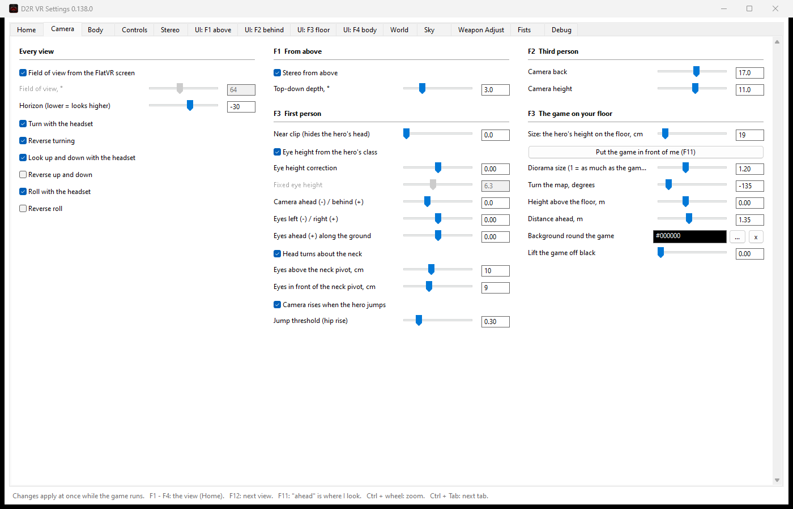

- **Every view** - the field of view (taken from the FlatVR screen by
  default), the horizon, and which head movements the camera follows: turn,
  look up and down, roll - each can be reversed.
- **F1 From above** - stereo from above and how deep the top-down 3D is.
- **F2 Third person** - how far behind and how high the camera is.
- **First person** - the near clip that hides your hero's own head, the eye
  height (from the hero's class, or fixed), where the eyes sit, turning the
  head about the neck, the camera rising when the hero jumps.
- **F3 The game on your floor** - the size of the diorama, *Put the game in
  front of me*, its turn, height and distance, the background round it. On
  native OpenXR it lies on the headset's own floor, wherever you stand, and
  the headset's recentre puts it down again in front of you.

## Body

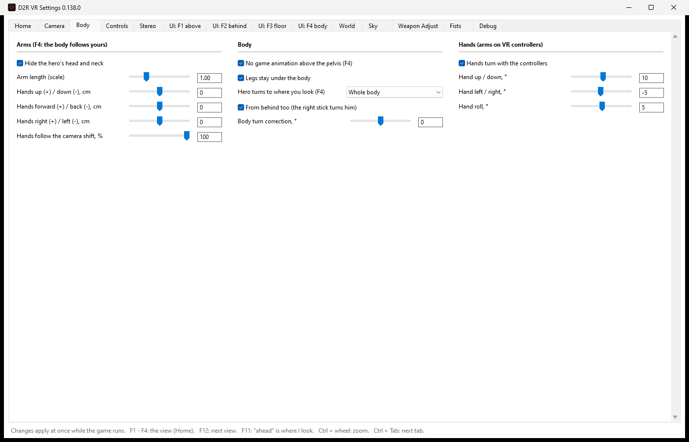

- **Arms** (F4) - hide the hero's head, arm length, shift the hands up, forward
  or sideways, how much the hands follow the camera.
- **Measured height and arm span (T-pose)** (native OpenXR) - *Measure my height
  and arm span...* puts a panel in front of you in the headset: stand upright,
  stretch both arms out sideways at shoulder height, let go of both triggers, then
  squeeze both and hold still for 1.2 seconds (right B cancels; it runs in first
  person, F4). It saves your eye
  height over the room's floor and the span between the controllers; the world's
  scale and the hero's arm bones then follow them (the hands stay 1:1 with the
  controllers). *Use the measured height and arm span* switches it on and off (a
  good measurement switches it on) -
  off is the height from BodyWalk / *My height* and *Arm length (scale)*, as
  before; *Forget the measurement* clears it. Needs the headset's floor (a room
  set up), not a seated-only space. With the settings panel in the headset
  (Stereo > Native OpenXR) the same measurement starts from its *Body* page:
  *Calibrate body*, *Forget measurement*, and the numbers stored. Its first
  page also switches the game view, F1 - F4, as the F keys do (the panel is
  F4's: F1 - F3 close it, and F4 is back with the F4 key or the Home page).
  With the skill panel in the tiles' look these pages are its *Settings* tab,
  beside *Skills*: the long press of the right stick click opens the window on
  the tab it was last on. The window flips like pages: flick a thumbstick left or
  right, tap a grip, or click the arrow at its edge (Skills | Settings: View,
  Options, Video, Body; dots show where you are).
- **Body** - no game animation above the pelvis in F4 (your body drives it),
  legs stay under the body, how the hero turns to where you look.
- **Hands** - the hands turn with the controllers; tilt, turn and roll offsets
  for your controllers' grip.

## Controls

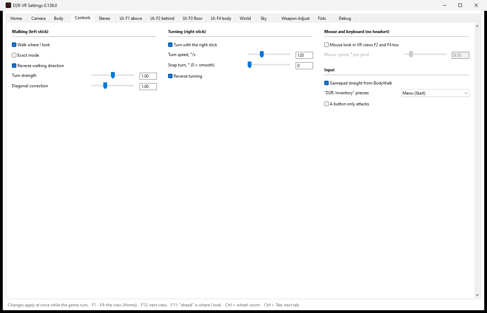

- **Walking (left stick)** - walk where you look, exact mode, reverse, turn
  strength, diagonal correction.
- **Turning (right stick)** - turning on the right stick; **smooth turning**
  on or off (off = one snap per flick), the **smooth turn speed** (10 - 720 °/s),
  the **snap turn angle** (15 - 180°), reverse. The mode is its own switch, so
  changing it keeps both the speed and the angle. The same three are in the
  headset (settings panel > Options). An older d2r_vr.ini that says snap = 0 for
  smooth turning keeps working as smooth turning.
- **Mouse and keyboard** - mouse look in the VR views F2 and F4 as well.
- **Input** - the gamepad straight from BodyWalk, which button *D2R: Inventory*
  presses, the A button only attacks. *Pick up / interact: one thing per press*
  (VR first person): a press acts on what is under it then and nothing else - a
  chest opened by a press does not also give you its loot, a hold over a pile
  takes one item; let go and press again for the next.
- **Gestures (native OpenXR)** - *Swap weapon sets*: reach a hand behind either
  shoulder and press its grip once, and the game's own *Swap weapons* is pressed;
  which hand (right by default). Off by default. *Draw gesture runes and trails
  in the headset* (a prototype): the runes BodyWalk scores when you draw a shape
  in the air, shown like a spell rune with a glowing trail of your hand. It needs
  a BodyWalk that sends them (not out yet): nothing shows until then. The
  controls of the plugin's own (*Controls without BodyWalk*, below) are on the
  Stereo tab.

## Stereo

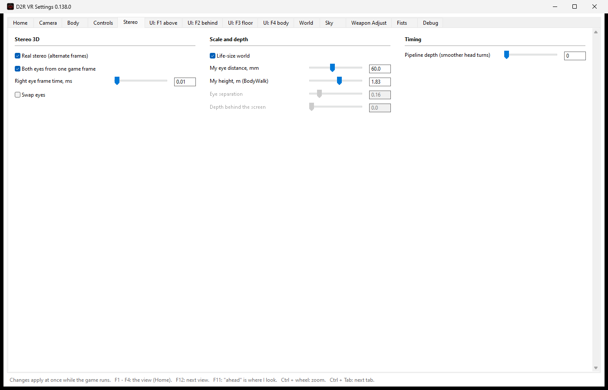

- **Stereo 3D** - real stereo: the game draws the left and the right eye in
  turn (or both from one game frame), the right eye's timing, swap eyes.
- **Scale and depth** - a life-size world from your eye distance and your
  height (both from BodyWalk), or eye separation and depth by hand.
- **Timing** - pipeline depth: a smoother head turn for a little more delay.
- **Native OpenXR** - the game itself in the headset: brightness, the flat
  picture's distance and width (*Menus placed only when the headset is
  tracked*, on: the picture and a menu's panel follow your gaze until the
  headset says it is tracked, and come up in front again when the headset's
  focus returns after a while), the square window (in VR only: flat mode keeps
  the window and resolution you set in the game). *F1 and F3 in real 3D*
  (on): the game on your floor is a diorama standing in your room that you walk
  round and lean over, and the view from above is a window onto the game that
  you look through and lean to see round things - with the headset's own eyes,
  like first and third person; off, they are the flat picture as before.
  Menus and loading stay the flat picture. *Show the game's mouse pointer in F1 and F3*: the cursor the game
  shows is hung on the ground where its mouse points, a picture only - the
  clicks and the mouse are untouched. (The *VR render size* - a
  slider from 1024 to 4096 pixels a side, or the headset's own recommendation by
  a tick box, while the game window keeps its size - is on Home, under "In the
  headset", with *Menus and the mouse follow the VR render size* (on): the
  game's interface is laid out over the whole picture and its mouse reaches
  all of it, so no menu edge is lost and the main menu's bottom
  row can be clicked when the window and the picture differ in size.) *Laser pointer on menus
  and panels* (a prototype): point a controller at the menus or a panel and its
  trigger clicks, with the grip held it right-clicks; the other hand's trigger
  and grip are Ctrl and Shift. *Item tooltips at once under the laser*: the
  game's own tooltip and its comparison with what you wear, with no wait and no
  Shift. *Controller vibration*: a short pulse in the hand
  when a blow of yours lands, a belt potion is taken or drunk, the laser clicks
  on a menu, or you pick something up or open it (the pulses only watch the
  game); its strength has a slider. Off: silent. *Steam Frame controllers:
  their own layout* (on): when the runtime offers the Frame's controllers as
  themselves, the left hand's D-pad down and up are its two face buttons (X and
  Y on a Quest controller) and the left View / right Menu buttons the menu;
  taken when the headset session starts. *Valve Index: the grip is how hard you
  squeeze* (off): an Index hand's grip is the handle's force sensor, so a
  relaxed hand round the handle no longer counts as a squeezed grip.
  With it, *a channel of its own
  for each hand* (on: each controller's motor has its own vibration action, so a
  pulse cannot go to the other hand) and *stop each pulse on time* (on: a pulse
  is stopped by its own call when its time is up, even while the game loads -
  some controllers buzzed on past a short pulse).
  - **Controls without BodyWalk** (a prototype, off, VR first person F4 only):
    the plugin reads both controllers itself and gives the game its gamepad, its
    actions and its key commands, so BodyWalk's buttons, gestures and tracking
    are not used meanwhile (FlatVR and BodyWalk can run on for the picture). The
    layout is a table in `[direct]` of d2r_vr.ini - one line per control, each
    can be rebound; in menus the controllers are the game's own gamepad layout.
    *Long press of a stick click* (half a second): the right one asks for the
    skill panel, the left one opens the inventory; a quick click is what it was
    (swap weapon sets, show items). *Quick click of the left stick: show / hide
    the map*. *BodyWalk's walking still walks the hero*: BodyWalk is given your
    head and hands (no buttons), and its left stick - nothing else - is mixed
    into the controller's own. *Play with the controllers in F1, F2, F3 without
    BodyWalk* (on, from 0.167): in those views the plugin's own controller is the
    game's gamepad too - the first person layout without its panels: triggers,
    buttons, both sticks, the game's actions and key commands. With BodyWalk
    running (its Game Link alive, or its gamepad moving) nothing changes there; a
    real pad that answers keeps its buttons, ours are added to it. The flat modes
    keep BodyWalk's controls, as before.
  - **Skill wheel** (a prototype, off, needs Controls without BodyWalk for the
    long press): the controller's skill slots in front of you. *Skill panel
    style*: a **Wheel** of eight wedges, or **Tiles**, a window made like the
    game's own controller skill dialog - two rows of six plates (A X B Y RB RT, and
    the same with the left trigger held), red where a slot holds a skill. Point
    with the laser and pull the trigger: from then on that trigger casts the
    slot, the game's own pad button; the centre is the basic attack. EDIT SKILLS
    puts any skill you have into a slot through the game's own setter. *Skill
    panel opens by*: a long press of the right stick click, or the left grip
    held and a click of the pointing hand's stick. Distance and width are
    sliders. The icons come from a cache made out of your own installed game
    (`tools/skill_icons`, never shipped); without it the panel shows names.

## UI: F1 above

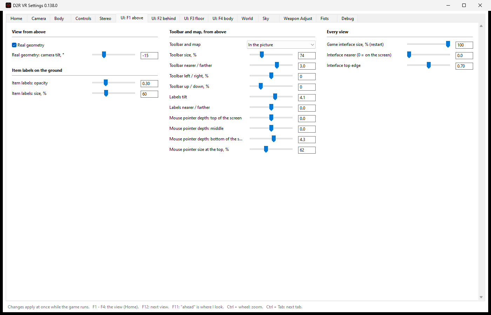

- **View from above** - *Real geometry*: the top view through our own camera in
  true perspective, and its tilt.
- **Toolbar and map, from above** - where they go (in the picture or the
  game's own way), size, distance, position; the tilt of the item labels; the
  depth of the mouse pointer at the top, middle and bottom of the screen, and
  how small it gets at the top.
- **Every view** - the game's interface size (restart), how near it floats,
  its top edge.
- **Item labels on the ground** - their opacity and size.

## UI: F2 behind

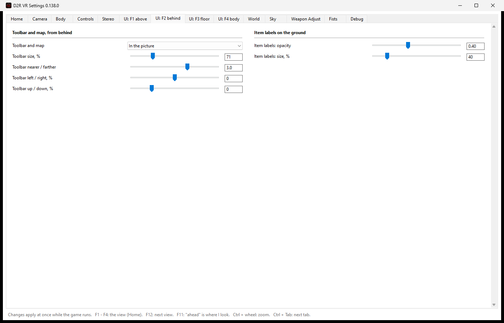

The toolbar and map in third person (where, size, distance, position) and the
item labels on the ground.

## UI: F3 floor

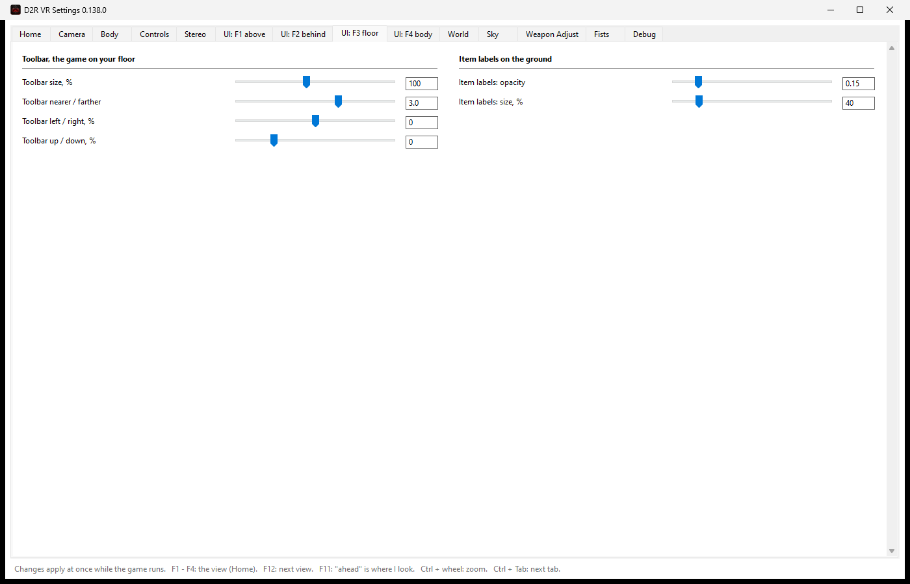

The toolbar while the game lies on your floor, and the item labels.

## UI: F4 body

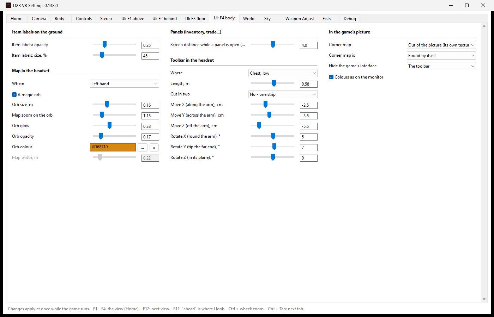

- **Map in the headset** - which hand holds it, as a glowing magic orb or a
  flat map: size, zoom, glow, opacity, colour.
- **Toolbar in the headset** - on your forearm or chest: length, one strip or
  cut in two, and its offset and turn. A fifth place, **Wrists: life left, mana
  right**, shows only your life and mana, as two balls on the back of the wrists
  like medallions (first person; the rest of the toolbar is not shown in the
  headset then): either real 3D glass - by default a **medallion**, a glass dome on a
  round metal base (gold, bronze or silver, with a **patina** you set, 0 - 100 %),
  flat on the back of the wrist; or the full glass ball - with liquid that rises and
  falls with the numbers, riding the drawn wrist and turning with it, drawn into the
  picture with depth, so a hand, a sleeve or a monster in front hides them - or the
  game's own life and mana globes, cut out of its toolbar as it draws them (with the
  real level of liquid) and laid on the same base (or, as a ball, a disc that is
  fixed on the wrist or turns to your eyes). **Fill direction** picks which way the
  liquid fills - along the arm either way, across the hand to either side, out of
  the hand (the default: from the skin up), or level in the world - each a fixed
  direction of the wrist's frame, never of your head. Next to the position, each wrist's medallion has a
  **rotation** about the wrist's three axes (X round the arm, Y across the hand, Z up
  off the hand, -180 to 180 degrees; the base, the dome and the fill direction turn
  together about its middle; the same numbers on the other wrist are the mirror
  image, and the mirror tick carries them over). The wrist bone and the arm's model differ with
  the class, so under **Wrists: depth per hero** each class (Amazon ... Warlock) has a
  depth (Z) offset, -5 to 5 cm, added to both wrists' Z while that hero plays; the
  line above the rows says which hero the game has now. Which wrist (or both on one), the size, the opacity and a soft
  heartbeat of the life ball at low life are settings. Each wrist's ball has its
  own place in that wrist's frame, from the wrist joint, in cm (-10 to 10): **X**
  along the arm (+ toward the knuckles), **Y** across the hand (+ toward the
  thumb, the same way on both hands) and **Z** up out of the back of the hand - a
  left set and a right set, and a tick **Right wrist mirrors the left** (off by
  default) that gives the right ball the left's three numbers. The older single
  "height" and "along the arm" settings are where each wrist starts from. It only
  reads your life and mana. Needs the new D2R_DepthFog.fx in ReShade.
- **Menus** - the laser pointer on menus and panels (a prototype), which hand
  holds it, the item tooltips at once, *Menus as a panel, the world stays in 3D*
  (on), and the settings panel in the headset:
  - **Settings panel in the headset** (a prototype, off): both grips squeezed for a
    third of a second, then a stick click. Pages: the game's view (F1 - F4),
    options (the picture's distance and width, brightness, your height, the
    laser), the VR render size and the body measurement. With the skill panel in
    the Tiles look these pages are its second tab, *Settings*, beside *Skills*:
    flick a stick left or right, tap a grip, or click the arrow at the window's
    edge to flip. *Apply* writes only what you changed into d2r_vr.ini.
- **Belt potions** - the belt's bottom row on the hero's hips as the game's own
  models (off); *take them in the hand and drink*, and where each is held.
- **Panels** - how far the screen moves back while the inventory or a trade
  window is open, so the whole panel is in view.
- **In the game's picture** - the corner map and which parts of the game's
  interface are hidden from the picture. With "The toolbar" hidden, two sliders,
  **Toolbar cut: higher / lower** (percent of the picture's height, 0 = as it
  always was), make the emptied strip taller above and below it, for a picture
  where bits of the statues' horns, hands or the globes' tops stay over the cut
  (a square 2048 picture at Safe Screen Percent 80 wants about 3 - 4 higher); a
  tick **Show the cut strip** paints the strip a see-through magenta so its edges
  can be seen while tuning.
- **Names over monsters** - the plate the game hangs over the monster you target:
  its opacity and size, and a tick to take the plates of ordinary monsters off
  the screen (a champion's, a unique's, a boss's and the NPCs' stay).
- **Item labels on the ground** - opacity and size.
- **Low life: red heartbeat vignette** (native OpenXR, off) - while your life
  is under a threshold (30% to begin with) the edges of what you see tint deep red
  and beat like a heart, faster and redder the lower your life goes; it fades in
  and out, and is never there when you are dead, in a menu or in any other view.
  A colour over the picture's edges only: nothing is scaled, moved or shaken. All
  sliders: the threshold; the intensity just under it and at the lowest life (in
  between it follows your life); the red's saturation (grey to deep red); the
  vignette's size (how far in from the edge it reaches, as an angle of your
  headset's real field of view), its edge's softness and its shape (oval to
  rounded square). A *gentle* mode is slower and softer, and the beat can be felt
  in the controllers too (Controller vibration on), stronger the lower your life
  - with a strength slider of its own. The middle of your view stays clear.
  Needs the new D2R_DepthFog.fx in ReShade.

## World

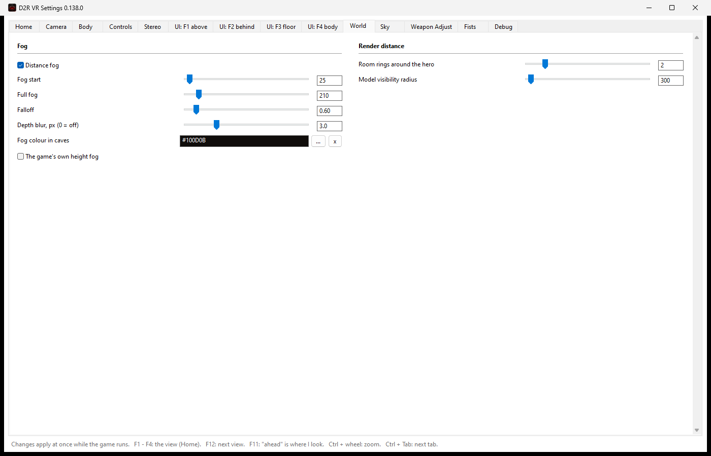

- **Fog** - distance fog, where it starts and where it is full, falloff, a depth
  blur, the fog colour in caves, the game's own height fog. *How that depth is
  set* (under *The game's effects measure depth from our camera*): in each pass
  as it is bound (as before), or once a frame where the game makes it (after
  bearstonem/d2r-pcvr: every pass - fog, ambient occlusion, particles, grass -
  reads the same depth); compare the two on the act 1 grass and the act 2 town. *Depth for the effects*:
**Our own, picked once** (the default) - the game's scene depth buffer is picked
once, kept until it goes away or the window or render size changes, copied for each eye before its
effects and bound once, so ReShade does not wait for the graphics card at every
effect pass - or **ReShade's own** (Generic Depth picks it; fine in a window that is
not square). A line under it says which buffer, how big and why it was last picked.
- **Render distance** - how many rings of rooms round the hero are drawn, and
  how far models stay visible.

The **Fog** group also has *Fix the game's lighting at a square or wide window*
(on): the game finds each light tile's depth range with a shader that is right at
a 16:10 window only, so at a square one lights vanished in hard rectangles; ours
does it right at any size (at 16:10 it gives the game's own numbers). Unticked it
works at once; ticked again it takes effect at the next start of the game. *... in
flat mode too* (on) gives the flat window the same fix (a little on a 16:9 monitor,
in full in a square window); the log tells the size the game draws at.

## Sky

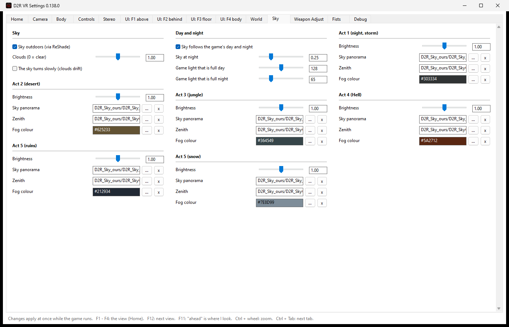

- **Sky** - a sky outdoors (drawn by our ReShade effect), clouds, slowly
  drifting clouds.
- **Day and night** - the sky follows the game's day and night, how dark the
  night sky gets, which game light counts as full day and full night.
- **Act 1 - Act 5** - per act (Act 5 twice: ruins and snow): brightness, the sky
  panorama and zenith pictures (your own work too: *...* picks one, *x* goes
  back to ours), the fog colour.

## Ceiling

- **Cave ceiling** - a stone vault over the black void in dungeons (first
  person), its relief, and what lights it: torches or any fire in the picture.
- **Light in caves** - the game's own light underground: how far the hero's
  circle of light reaches and how bright it is, and the light that fills the
  place (times the area's own, at least a set amount). For headsets that lose
  the darkest shades (an LCD such as Meta Quest).
- **Ceiling: <dungeon>** - each dungeon's own height, brightness, relief and
  stone picture.

## Weapon Adjust

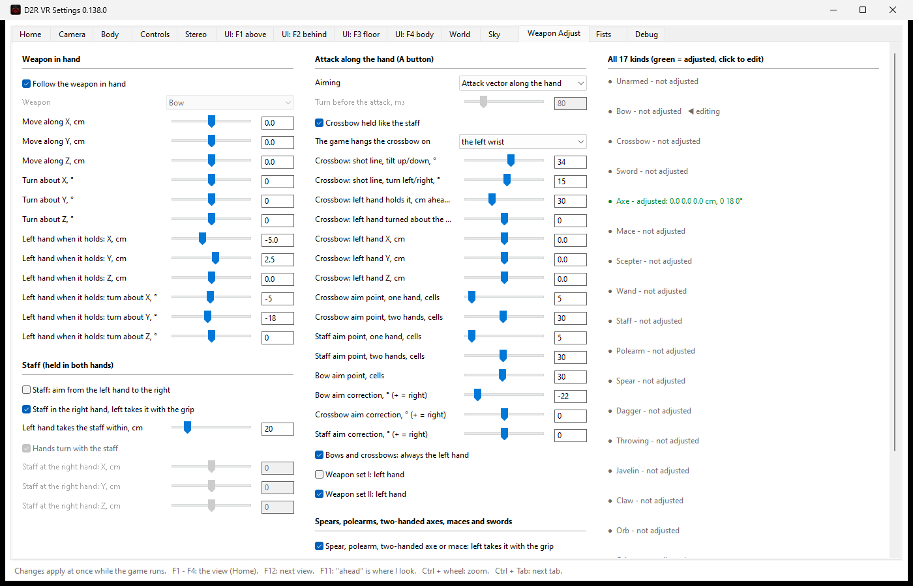

- **Shield (first person)** - *Shield strapped to the forearm* (on): the shield
  sits on the left forearm as the rig has it, not on the hand, and turns with the
  forearm; six sliders move it along and turn it about X, Y and Z. *Forearm turns
  with the wrist* (on): rolling a controller turns the forearm with it - a little at
  the elbow, all of it at the wrist - and *Forearm's share of the roll* sets how much
  the elbow end takes.
- **Weapon in hand** - follows the weapon your hero holds now; move and turn it
  in the hand, and where the left hand takes a two-handed weapon (one setting
  for all of them).
- **Staff** - right hand holds, left takes it with the grip and slides along
  the shaft.
- **Attack along the hand (A button)** - aiming along your hand; how far ahead
  bows, crossbows and staves aim; which hand holds bows and each weapon set.
  Five guards, F4 only, all on but the last: *Attacks never walk the hero* (every
  attack the plugin presses is pressed with the game's own Stand Still, and a
  click on bare ground gets it too, so with nothing under the point it is a swing
  or a shot in place; skills that move the hero and pick-ups are left alone),
  *No stray mouse clicks in the world* and *No stray walks* (a mouse button the
  plugin did not send, or a walk or run to a point out of a click on bare
  ground, does not reach the game - the hero no longer runs forward in the middle
  of a shot), *A shot along the hand never sends the hero after a monster*
  (before a pad cast the game looks for a target near the aim and takes Stand
  Still off the cast; that first look now finds none for a shot along the hand)
  and *An attack never runs the hero off* (off: a net for the run the game starts
  out of a pad cast).
- **Melee: hit by touch** (F4, off) - the blade you swing through a monster's
  body picks the target and the moment of the game's own attack (the attack
  button is pressed on the contact, the monster you touched is its target). The
  game's animation, reach, hit rolls and attack speed stay the game's. *The least
  blade speed that hits* (0.8 m/s) and *how far the blade moves to start a
  stroke* (8 cm) are sliders; a monster is hit once per stroke, allies and
  monsters behind a wall are left alone. *Thrown weapons hit by touch too* (on
  with it): a javelin, knife or axe swung through a monster is the game's Throw at
  it, point blank; potions never. *Shield bash casts Smite* (off): with Smite on a
  pad skill slot, a hard bash of the shield through a monster casts one Smite at
  it. *Shield bash: the least speed* (0.8 m/s) and *how far the shield moves to start
  a bash* (8 cm) are the bash's own numbers, apart from hit by touch's. *Direct hit* (experimental, off, offline only): the touch calls the game's
  basic attack itself - no animation, no walk-up, no attack-rate wait. The blade
  is built from the weapon as it is drawn; its length, thickness and direction
  are sliders on the Debug tab, and *Draw the capsules of Hit by touch* shows
  what is tested. *Quick strike* (experimental, a change of the game's timing): the
  game lands a melee blow at an action frame of the attack animation (a Paladin's
  sword: frame 7, 0.28 s in); this moves that frame to the start (a slider, 1 by
  default) so the blow lands about a quarter of a second sooner inside the same
  attack. The animation's length and the attack rate stay. The melee rows of the
  hero's class and the Paladin's Smite, never the bow, throws, spells or kicks;
  offline only; put back exactly when off.
- **Bow** (F4, off) - *Draw the string with both hands*: the free hand's trigger
  (or its grip) at the bow's string, pull back along the line to the bow and let
  go; the game's own attack, or the pad button of a skill you pick (Magic, Fire,
  Cold, Ice, Exploding, Immolation, Freezing, Guided Arrow, Multiple Shot,
  Strafe), is pressed once and the arrow goes along your draw. The length of the
  pull adds nothing. *A press away from the string shoots nothing* (on). The grab
  zone's radius and shift and the least pull that shoots are sliders.
  *The bow's string and limbs follow the drawing hand*: the game's own bow, string
  and arrow follow the pull, for any of the 15 bow models; the arrow rest (a
  point in the bow hand's frame the arrow passes), keeping the arrow clear of the
  hand and forearm, *the bow lies along the line between the hands*, and *the hand
  that takes the string: fingers hooked on it* (the game's own draw pose, or a
  fist table; sliders for the curl and the thumb), and *the string is held at the
  fingers' first joints* (on): the nock, the arrow's line and the bow's turn along
  the hands start where the game's draw animation has the hooked fingers, not at
  the middle of the palm (the Amazon's right hand; sliders move that point).
  *Quick release* (experimental): moves the game's arrow-making
  frame of the hero's bow attack earlier (frame 2 by default) - the arrow, its
  damage and its mana come about 0.2 s sooner inside the same attack; the
  animation and the attack rate stay. Offline only; put back exactly when off.
- **Throws** (F4) - *Throw a javelin with a throwing motion* (off): hold the right
  trigger, swing, let go; with Controls without BodyWalk the right **grip** does
  the same (*throw by the grip*, on). The throw is the game's own attack, aimed
  along your hand's motion; *Throws use the Throw skill by themselves* (on);
  *Throw auto-aim* (15 degrees, 0 = off) snaps the aim to a hostile monster in a
  cone round the line of your hand; *Throwing potions: how far* (800 %) and when
  the game's own throw happens; *explode where and when the potion lands*
  (experimental, off); *Throwing potions: our potion flies, the game's throw is
  hidden, the explosion where it lands* (experimental, off): one tick for a
  potion that only yours is seen - your potion (the weight model's) flies the
  whole trajectory, the game's own flying potion is not drawn (*The game's own
  flying potion is not drawn*, experimental, off: only what is drawn, never the
  game's missile, damage, stack or explosion) and the game's explosion happens
  where yours lands; *Throws are pressed with the game's Stand Still* (on).
  With Weapon Weight on, how far a throw goes is worked out by the weight model.
  *Quick throw* (experimental, a change of the game's timing): the same for a
  throw - the missile of a javelin, knife or axe is made at the start of the
  throw animation (a slider) instead of about 0.36 s in; a throwing potion keeps
  the game's timing unless *Quick throw: throwing potions too* is ticked.
- **Crossbow** - the shot line and the left hand's place.
- **Spears, polearms, two-handed axes, maces and swords** - the left hand takes
  them with the grip.
- **All 17 kinds** - green = adjusted; click one to edit it.

## Weapon Weight

F4 with the arms on the controllers, off by default (being tested).

- **Weapons have weight** - a melee weapon held alone is heavy: it lags behind
  a hard swing, a two-handed one wants both hands, a spear held by its end is
  slower than held where the game holds it. **Weight** (% of the real mass; 50 to
  begin with, 100 = the real mass) and **Hands' strength**.
- **Gravity feel** (ticked) - the weight is gravity, not a drag: the wrists are
  soft near the line of your controller, so a sword held out level sinks a few
  degrees, a polearm or a two-hander in one hand sinks a lot (two hands hold it
  much better), a swing down is helped by the weight and lifting up is slowed by
  it, a dagger hardly feels it - and a hard cut is still followed. **Gravity, %**
  (100 = the real 9.8 m/s2; 0 = no gravity, only inertia: the weapon lags the same
  way up and down) and **Damping, %** (100 = nearly critical; the damper follows
  your controller's speed, it is not a drag) are live. Unticked: the old stiff
  wrists, where the weight showed only as a lag (Gravity and Damping still work).
  A weapon you let go always falls at the real g.
- **Taking and passing** - a hand holds the weapon while its grip is
  squeezed, where it closed on the shaft; let a grip go and that hand lets go,
  the other keeps it. Let both go and the weapon falls to the floor: take it up
  there, or squeeze the grip of the hand the game holds it in, away from it, and
  it flies back into that fist. A new weapon sits in the game's hand until you
  first let that grip go. How near a grip takes it, and where the fist sits
  round the shaft. **The second hand slides along a long shaft** (ticked): with
  two hands on a staff, spear, polearm or two-handed sword, axe or mace the first
  hand holds where it took it and the second, while its grip stays squeezed,
  slides along the shaft with its controller (as the left hand did on a staff
  before); off the end of the shaft, or pulled away from it, it lets go.
- **Keep the weapon's two attach bones apart (the staff is not flat)** (ticked) - the
  game lays a two-handed weapon (a staff, a spear, a polearm, a two-handed sword, axe
  or mace) along the line between its two attach bones, one on each wrist. A weapon
  with weight is drawn where the model has it, and with both bones put in one point
  that line has no length: the weapon is drawn squashed flat along its length - the
  staff as a dark disc, with the grip and the red line right. Ticked, the second bone
  is kept 40 cm (`[hands] carry_cm`, in the ini) along the weapon's own axis from the
  first, as it always was for a weapon in hand; the weapon keeps its length and lies
  where the model has it. Unticked: both in one point. The log says once for each
  weapon what the game's own two bones look like.
- **Grip fit (the hand on the shaft)** (ticked) - a hand that *takes* the weapon
  (it closes its fist on the shaft: the second hand, a hand that takes it over from
  the other, the game's hand taking it up again) sits on the shaft like the base
  grip: the middle of its palm goes onto the shaft's axis - the red line - at the
  place it took it, the line through its knuckles is laid along the shaft (the roll
  about the shaft stays your controller's), and its fingers close round it as you
  squeeze the grip - also with "Free hands make a fist" off (unless the fingers tick
  below gives them the game's own grip pose instead). **The taking hand sits on
  the shaft like the game's own grip** (ticked): the game's own pose of the hand it
  holds the weapon in is the reference - how far its palm stands from the axis (across
  the hand and out of the palm) and how its knuckle line leans to the shaft is measured
  live, and the taking hand is given the same, so the two hands sit on the staff the
  same way (unticked: the palm exactly on the axis). **The taking hand's fingers take
  the game's weapon-grip pose** (ticked): the fingers and the thumb of the hand that
  takes the weapon get the pose of the hand the game holds it in - wrapped round the
  shaft, the thumb on it - read off the game's own animation and put on the taking hand
  mirrored as that hand needs (in the hand's own frame, whichever way the rig labels
  its bones). It is held as it is while the hand holds the weapon - your squeeze no
  longer closes the fingers - and they open as the hand lets go or hands the weapon
  over; "Free hands make a fist" has nothing to say about a hand that holds the weapon.
  The same for a staff, a spear or a sword in two hands (whatever the game's hand does
  on that weapon), either hand taking it, the left taking over from the right. During a
  swing the pose stays the one read while you were calm. Unticked: the fingers close
  with your squeeze as before. The fist sliders above
  decide *where along the shaft* a hand takes it. **Live correction sliders, one set
  for each HAND - Right hand and Left hand**, whatever state it is in (the game's hand
  as placed - its base grip is the game's own, these only move it from there; or a hand
  that took the weapon, on top of the fit; carrying it or not; one hand or two). X, Y, Z
  in cm and the rotations X, Y, Z in degrees are in the **shaft's own frame at the
  place the hand holds it, turned as the hand holds it** - so a fix found for one
  grip is right at any roll of the wrist: X along the shaft (+ toward the tip), Y
  across (+ toward the fingertips), Z up (+ out of the palm); rotation X is the roll
  about the shaft, Y the tilt about the across axis (the fingers up or down), Z the
  tilt about the up axis (the fingers sideways). The same numbers on the two hands make
  mirror images. The base hand's corrections are part of how it is drawn, so a hand that
  took the weapon copies them (while "like the game's own grip" is ticked). The weapon
  never moves with these sliders, only the hand (the arm reaches to it again, the
  fingers follow). All zero and the hand just sits on the shaft. With [debug]
  phantom_ray on (*See it*) each fitted hand shows a yellow dot where it takes the
  shaft, a green ring where its palm really is and a white line between them: they
  coincide when the arm reaches and the corrections are zero. The log says, once per
  take, how far off the shaft the palm was and how far off the shaft the knuckles
  lay, and what it was laid like. Unticked: the hands are drawn at the controllers
  as before (and "Free hands make a fist" alone decides whether they close).
- **A dropped weapon** - what becomes of a weapon you let go, once it has landed:
  *Lies on the floor* (as before), *Goes to the back* (the default) or *Vanishes*.
  After **Delay on the floor** (0.6 s) it disappears from the floor and, on the
  back, hangs there: a staff, spear, polearm, javelin or any two-handed weapon
  diagonally across it with the tip over the shoulder, a one-handed one low across
  the back; it follows his body and shakes not. Vanishing, it is not drawn at all.
  The game's weapon stays his equipped one either way. To take it back: reach a
  hand to where it hangs - **Take zone at the weapon on the back** (25 cm) from
  its wood, anywhere along it - or behind either shoulder, and squeeze the grip:
  the weapon flies into that hand, and the controller gives a short pulse as the
  hand enters that zone (a pulse strength slider; needs the haptics box); that
  grip is the weapon swap only while nothing is away. A squeeze that takes
  nothing is told in the log, with how far the hand was. **The grip of any free hand calls it back** too,
  squeezed anywhere (the game's hand always does; untick it and only the game's
  hand and the shoulder do). A weapon that is away strikes nothing. Live sliders
  (x, y, z in cm, pitch, yaw, roll in degrees) place it on the back, one set for
  long weapons and one for short ones.
- **See it** - the red line along the shaft, where a grip can take it. It is the
  weapon's own bone as drawn - the same line and the same ends as the cyan
  capsule of hit by touch (a short staff's wood is 1.3 m, 0.66 m each way of the
  bone) - so a grip takes the weapon where the staff is. It is measured against
  the drawn weapon on every pose, with one hand or two, walking or standing, to a
  fraction of a millimetre; the log says if it was ever more than 1.5 cm off, or
  could not be measured.

With it on, Weapon Adjust's staff and two-handed left-hand settings give way to
it (`[hands] staff_free_left` and the other two-handed settings stay as they
are for when this box is off).

The grips still do their other jobs: a grip next to the belt is a potion, not a
weapon (a hand with a bottle in it, or one lit to be taken, takes nothing), and
a grip behind a shoulder is the weapon swap (that hand takes no weapon; the
swapped-in weapon sits in the game's hand as a new one). Letting the weapon
hand's grip go to press it again behind the shoulder lets the old weapon fall
for that moment. With "Controls without BodyWalk" a grip that holds the weapon
is taken from the layout, so it does not turn the same hand's buttons into the
grip chords (B stays B). It works with BodyWalk's tracking and with native OpenXR,
with or without "Controls without BodyWalk" - and only in first person (F4):
in any other view, or with the box off, nothing here acts.

A javelin or a throwing weapon in the right hand follows the same rules (held
while the grip is squeezed, let go it falls and lies, the grip squeezed again
calls it back). The one exception: with the throw gesture's "throw by grip"
(Weapon Adjust > Throws), a grip let go as a throw lets the weapon's model leave the
hand and fall with the motion it had, like a drop - but it does not lie on the
floor or go to the back. The game throws a missile of its own, so a model
flying on beside it would be a second weapon: **A thrown weapon's model**
(*Vanishes when the game throws*, the default): the model is gone the moment the
game takes the throw, and the hand stays EMPTY - the weapon is not drawn - while
the game's own throw animation plays (**The hand stays empty while the game
throws**, at most 0.9 s: it never stays hidden if the animation signal is lost);
then the game's next one is in the hand. If it was the last one the game takes it
out of the hand anyway. **The model flies out of the hand this long** (0 by
default) lets the model first FLY OUT of your hand along the throw (with the
speed your hand gave it) and hand over to the game's missile when it is up, or
that many milliseconds after the release, whichever comes first.
*Flies on until it lands* keeps it falling until it lands, the game's throw
animation is over, or **A thrown weapon's model flies at most** (3 s) from the
release. If the game refuses the throw (no Throw skill on a pad slot, nothing to
aim at), the model's flight is all there is and it ends by landing or that time
either way. The game's own missile flies and hits as ever.

A throwing **potion** is the exception: **Your potion flies all the way to its
landing** (ticked): its model is not handed over to the game's missile when the
game takes the throw; it flies the whole thrown trajectory and breaks at its
landing (gone, the next potion in the hand), or after **A thrown weapon's model
flies at most**. The game's own flying potion is drawn too unless you tick *The
game's own flying potion is not drawn* (Weapon Adjust > Throws, experimental).

**How far a throw goes** is worked out by the weight model, not by the hand's
raw speed: the weapon's peak velocity in the last 0.15 s before the release,
as the hand really moved it, against the weapon's weight (a light knife or
javelin leaves fast, a heavy axe or polearm slower: the same swing goes far or
short), flown over the real ground. A real arm throws a few metres, so
**Throws: how far** (800 %) scales the horizontal part of that velocity (the fall
stays real), and **Throws: the farthest** (48 cells, the most the game's own aim
check allows; about 26 m at 0.55 m a cell) holds the landing. The throws of
weapons and potions (Weapon Adjust > Throws) land where this says while Weapon Weight is on.

**Hit by touch** follows the weapon as it is drawn: the hand that carries it
swings it (passed to the other hand, that hand does), and a weapon no hand holds
- falling, tipping over, lying on the floor, flying back - strikes nothing.

## Fists

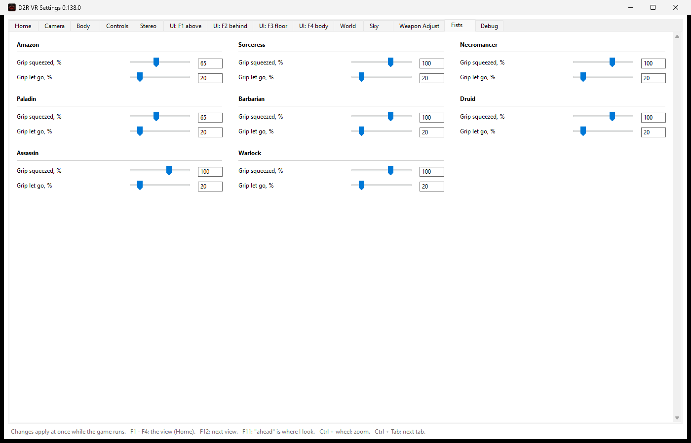

Per class: how far the hero's fingers close when you squeeze the controller's
grip, and when you let go.

## Auto-target

*Disable auto-target for spells* (on): in first person a spell that flies - Fire
Bolt, Charged Bolt, Bone Spear, Frozen Orb... - goes where your hand points, as
every attack does, and the game's auto-target and aim assist are off for that
cast. Spells placed on the ground, summons, curses and auras keep the game's
targeting. Below, a tick for each spell keeps the game's auto-target for that
one - for spells that seek their target themselves (Guided Arrow, Chain
Lightning and Bone Spirit are ticked).

## Debug

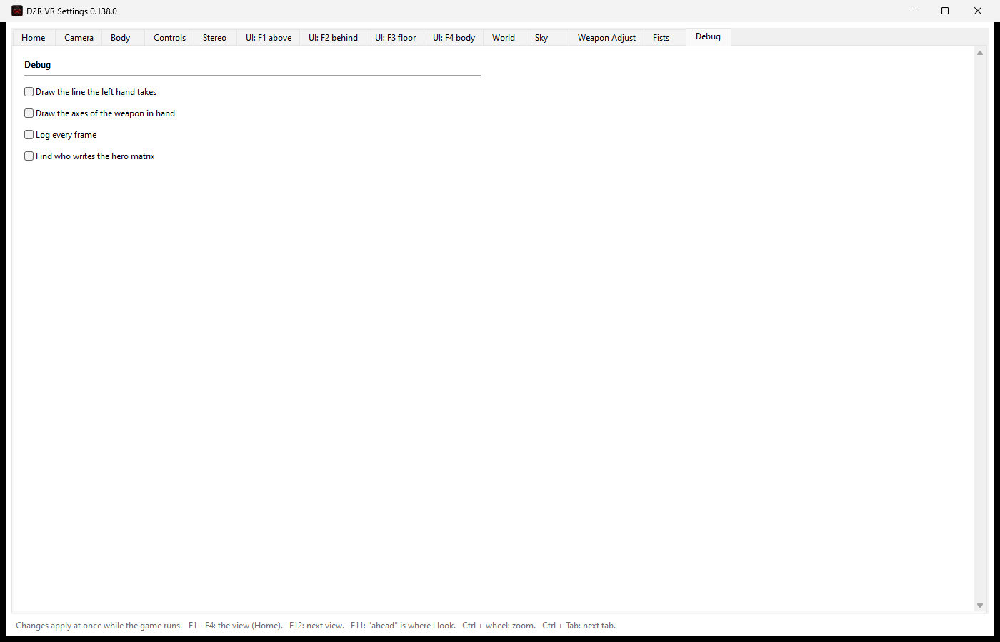

For finding problems: draw the line the left hand takes, draw the weapon's
axes, log every frame, find who writes the hero matrix. Leave these off to play.
New, all off: *Draw what casts skills* (the shield bash's capsule, speed marks and trail
in the headset, and a line in the log of why a bash did or did not count); *Draw the capsules of Hit by touch* and the blade's length,
thickness and direction (and the thrown kinds' own); *Log what the game does with
each attack of ours* (`shot_trace`); *Log the long frames and what the plugin
spent in them* (`frame_trace`) and *Write the plugin's log from a thread of its
own* (`log_async`) for a stutter; *Log where the time goes between a bow's release
and its arrow*; the bow's draw vectors in the headset. After a throw the log tells
for five seconds what the game does with it (`throw_trace`, on, read only).
